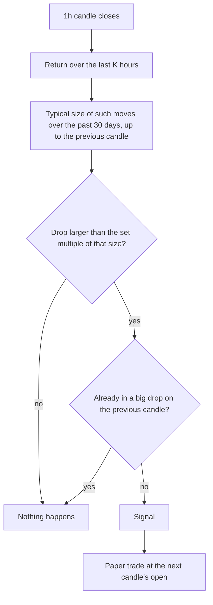

# Big-move fade

**Experiment · weak evidence, before 2019 only · runs on 1h only**

Fires after an unusually large drop over the last 1, 2 or 4 hours, betting that part of it
bounces back. One study found Bitcoin's hourly moves partly reverse, more so after big jumps,
and blamed chains of forced selling by leveraged traders.

## What it looks for

A sudden hourly drop much bigger than normal for that coin. "Normal" is measured as the
standard deviation of its returns over the last 30 days, calculated up to the candle before
the drop so the drop cannot shrink its own yardstick.

## How it decides

## Settings

| Setting | Value |
|---|---|
| Move sizes tested (each scored separately) | {{FADE_HOURS}} hours |
| Big means a drop larger than | {{FADE_SIGMA}} standard deviations |
| Typical size measured over | {{FADE_VOL_DAYS}} days |
| Target / stop / time limit | {{TARGET_ATR}}× / {{STOP_ATR}}× ATR({{ATR_WINDOW}}) / {{TIME_LIMIT_BARS}} candles |

## What studies found

- Bitcoin's return autocorrelation was −0.056 at 1 hour and −0.086 at 2 hours (Bitstamp,
  2015–2018), with bigger reversals after bigger jumps. No costs were included.
  [De Nicola](https://ledgerjournal.org/ojs/ledger/article/download/213/212/1232)
- On **daily** candles the opposite holds: after unusual days, major coins tend to keep going
  the same way the next day. [Caporale and Plastun](https://link.springer.com/article/10.1007/s11408-020-00357-1)
- This signal is the only one here that bets against the move, so it needs its own proof.

## Our scorecard

{{scorecard:big_move_fade}}

## Real examples

{{examples:big_move_fade}}

## Known weaknesses

- A big drop is sometimes the start of a crash, not a dip. The stop is what limits the damage.
- The edge in the study was small per hour; fees can easily eat it.
