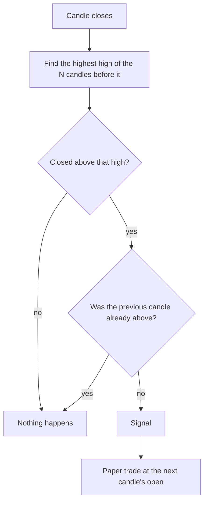

# Donchian breakout

**Main signal · moderate evidence in studies · runs on 1h, 4h and 1D**

Fires when a coin closes above the highest price of the candles before it. The idea is
simple: a coin that escapes its recent range often keeps going for a while.

## What it looks for

A stretch of sideways or falling prices, then one candle that **closes** above the top of
that range. A wick that pokes above the range and falls back does not count. Only the first
candle of a breakout fires; the candles after it, still above the old high, stay quiet.

## How it decides

1. Wait for the candle to close. A candle still forming is never used.
2. Take the highest high of the N candles **before** this one (this candle is excluded).
3. If the close is above it, and the previous candle's close was not above its own range,
   the signal fires.
4. A paper trade opens at the next candle's open.

## Settings

| Setting | Value |
|---|---|
| Lookbacks tested (each scored separately) | {{DONCHIAN_LOOKBACKS}} candles |
| Target | {{TARGET_ATR}} × ATR({{ATR_WINDOW}}) above entry |
| Stop | {{STOP_ATR}} × ATR({{ATR_WINDOW}}) below entry |
| Time limit | {{TIME_LIMIT_BARS}} candles, by timeframe |

## What studies found

- In the largest crypto test of trading rules (about 15,000 rules, daily data to 2017),
  **channel breakouts were among the best groups**, profitable up to 30–144 basis points of
  cost. But the **plain "close above the N-day high" rule, which is what this signal is, was
  the weakest group**, surviving only 8–16 basis points of cost. The best Bitcoin channel rule
  then lost money in early 2018. [Hudson and Urquhart](https://d-nb.info/1202710646/34)
- Range breakouts beat buy-and-hold on Bitcoin over 2010–2019 except in 2015–16: they pay in
  trending years and bleed in flat ones. [Gerritsen et al.](https://www.sciencedirect.com/science/article/abs/pii/S1544612319303770)
- An unrefereed practitioner paper reports that **averaging many lookbacks** (5 to 360 days)
  was much sturdier than any single one. [Zarattini et al.](https://papers.ssrn.com/sol3/papers.cfm?abstract_id=5209907)
- On 1-minute candles, breakout buy signals had **negative** returns, so very short intraday
  breakouts are contradicted. [Corbet et al.](https://repository.bilkent.edu.tr/bitstreams/2ad07cf4-372b-40f4-92b5-b042e62863c4/download)

## Our scorecard

{{scorecard:donchian}}

## Real examples

{{examples:donchian}} — one that worked and one that failed, drawn from the paper-trade log.

## Known weaknesses

- Breakouts that fail straight away are common; the 1× ATR stop takes many small losses.
- In sideways markets it fires again and again at the top of the range.
- Many coins often break out on the same day, so one market move can produce ten signals
  that are really one bet. The scorecard counts them by week for that reason.
