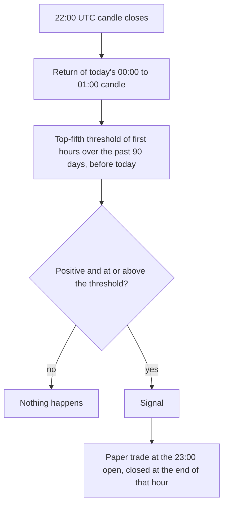

# Intraday momentum

**Experiment · weak evidence, before fees · runs on 1h only**

When the first hour of the UTC day is unusually strong, buy the last hour of the same day.
A 2022 study found that the start of the crypto day predicts its end, especially on days
with big jumps.

## What it looks for

The return of the 00:00–01:00 UTC candle. If it is positive and in the top fifth of the last
90 days' first hours, the app buys at 23:00 and sells at the end of the day.

## How it decides

## Settings

| Setting | Value |
|---|---|
| Strong means at or above | the {{INTRADAY_MOM_TOP_QUANTILE}} quantile of the past {{INTRADAY_MOM_HISTORY_DAYS}} days |
| Holding time | 1 candle (the last hour of the UTC day); no target or stop |

## What studies found

- Intraday momentum and reversal both exist in crypto, and the link from the first half-hour
  to the last half-hour is stronger on jump days. The study reports results before fees.
  [Wen et al. 2022](https://www.sciencedirect.com/science/article/abs/pii/S1062940822000833)
- The study used half-hour periods. This app uses whole hours because it works from 1h
  candles, so it tests a looser version of the idea.

## Our scorecard

{{scorecard:intraday_momentum}}

## Real examples

{{examples:intraday_momentum}}

## Known weaknesses

- One hour is a very short trade: a 0.25–0.40% round-trip cost is large next to a typical
  hourly move, so the signal needs a big edge to survive.
