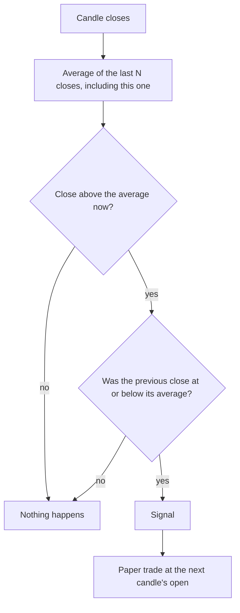

# Trend state

**Main signal · moderate evidence in studies · runs on 1h, 4h and 1D**

Fires when a coin's closing price crosses from below its moving average to above it. In
studies, simply being above a 20–50-day average was one of the few signals with support in
crypto. Its main benefit was smaller losses in bad periods, not bigger gains.

## What it looks for

The average price of the last N candles is a slow-moving line. While the price sits below
it, the coin is in a downtrend by this definition. The signal fires on the candle that
**closes** back above the line.

## How it decides

1. Wait for the candle to close.
2. Compute the simple average of the last N closes.
3. If this close is above it and the previous close was not, the signal fires.
4. A paper trade opens at the next candle's open.

## Settings

| Setting | Value |
|---|---|
| Moving averages tested (each scored separately) | {{TREND_MA_WINDOWS}} candles |
| Target | {{TARGET_ATR}} × ATR({{ATR_WINDOW}}) above entry |
| Stop | {{STOP_ATR}} × ATR({{ATR_WINDOW}}) below entry |
| Time limit | {{TIME_LIMIT_BARS}} candles, by timeframe |

## What studies found

- Holding Bitcoin only while it was above a 5–100-day average raised the Sharpe ratio from
  1.9 to 2.1–2.5 and cut the worst drawdown from 89.5% to 64–70% over 2010–2018.
  [Detzel et al.](https://community.portfolio123.com/uploads/short-url/jS0qs8gndLATbD3WlYQ79thDnzD.pdf)
- On the ten largest altcoins of 2016–2018, the 20-day version beat buy-and-hold by 8.76% a
  year before costs; the 100–200-day versions did not.
  [Grobys et al.](https://osuva.uwasa.fi/server/api/core/bitstreams/6d20e4ef-7741-419e-b2ea-0cb103bfa1dd/content)
- Across 3,244 coins, those above their 20-day average beat those below by 3.13% a week
  (t = 3.80). The 200-day version showed nothing (t = 0.05).
  [Fieberg et al.](https://www.cambridge.org/core/services/aop-cambridge-core/content/view/4C1509ACBA33D5DCAF0AC24379148178/S0022109024000747a.pdf/trend_factor_for_the_cross_section_of_cryptocurrency_returns.pdf)
- Rules picked on 2017–2021 Bitcoin and Ethereum data failed in 2022–23.
  [Chen et al.](https://pubs.sciepub.com/jfe/11/4/2/index.html)
- Note: the studies support being **above** the average as a state. This signal tests the
  moment of **crossing**, which no crypto study isolates. The "golden cross" (50 over 200)
  has no crypto evidence at all.

## Our scorecard

{{scorecard:trend_state}}

## Real examples

{{examples:trend_state}}

## Known weaknesses

- In choppy markets the price crosses back and forth, firing many signals that go nowhere.
- A crossing is late by design: it fires after part of the move has already happened.
