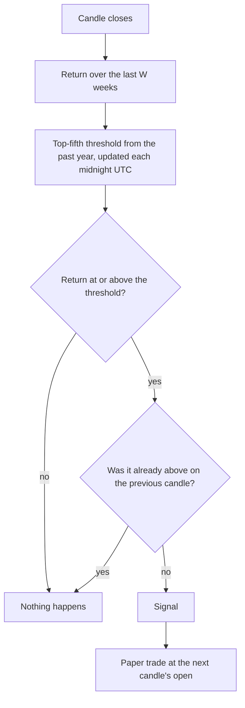

# Time-series momentum

**Main signal · moderate evidence in studies, mostly before 2019 · runs on 1h, 4h and 1D**

Fires when a coin's own return over the last 1, 2 or 4 weeks becomes unusually strong
compared with its past year. The idea: in crypto, strong weeks have tended to be followed by
more gains over the next one to four weeks.

## What it looks for

Not a shape on the chart, but a number: the coin's return over the last few weeks. "Unusually
strong" means in the top fifth of all such returns for that coin over the past year. The
signal fires on the first candle that enters that top fifth.

## How it decides

1. Wait for the candle to close.
2. Compute the coin's return over the last W weeks.
3. Compare it with the top-fifth threshold of the coin's own W-week returns over the past
   year. The threshold is recalculated once a day at midnight UTC, using only past data.
4. If the return just crossed into the top fifth, the signal fires. At least half a year of
   history is needed first.

## Settings

| Setting | Value |
|---|---|
| Lookbacks tested (each scored separately) | {{TS_MOMENTUM_WEEKS}} weeks |
| Strong means at or above | the {{TS_MOMENTUM_TOP_QUANTILE}} quantile of the past {{TS_MOMENTUM_HISTORY_DAYS}} days |
| Target / stop / time limit | {{TARGET_ATR}}× / {{STOP_ATR}}× ATR({{ATR_WINDOW}}) / {{TIME_LIMIT_BARS}} candles |

## What studies found

- A one-standard-deviation rise in Bitcoin's weekly return (about 16.6%) predicted +3.16% and
  +3.66% over the next one and two weeks. The data ends in 2018.
  [Liu and Tsyvinski](https://www.nber.org/system/files/working_papers/w24877/w24877.pdf)
- No out-of-sample test after 2021 was found. Momentum returns in crypto have very fat tails,
  so a few huge weeks can dominate the average.
  [Grobys and Shahzad](https://ideas.repec.org/a/wly/ijfiec/v31y2026i2p2180-2193.html)
- Momentum in crypto tends to reverse after about 4–6 weeks.
  [Dobrynskaya](https://papers.ssrn.com/sol3/papers.cfm?abstract_id=3913263)

## Our scorecard

{{scorecard:ts_momentum}}

## Real examples

{{examples:ts_momentum}}

## Known weaknesses

- It buys after a big run-up, which is exactly when sharp pullbacks are common.
- The evidence is old; the effect may have been traded away.
