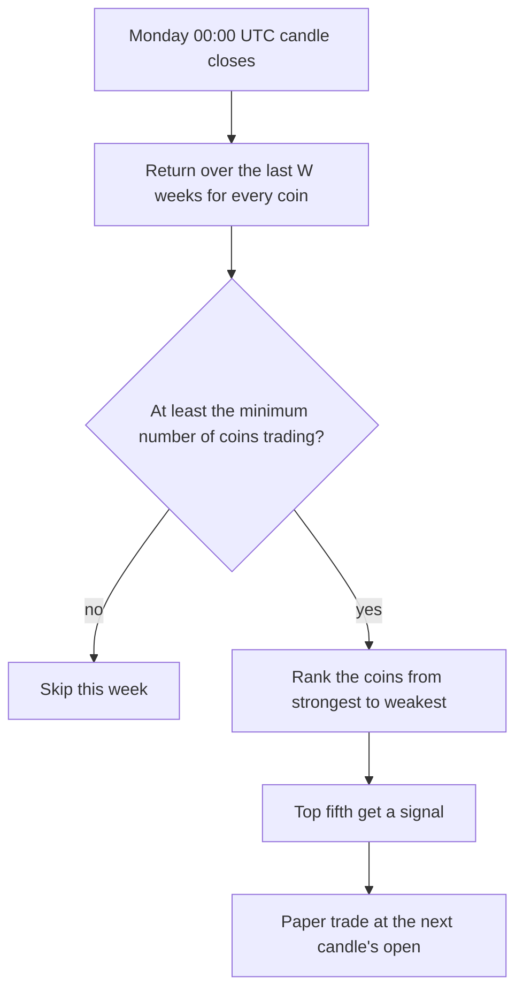

# Cross-sectional momentum

**Main signal · strong in early studies, disputed since · runs on 1h, 4h and 1D**

Once a week, ranks all coins by their return over the last 2 or 3 weeks and signals the top
fifth. The idea: recent winners among large coins have tended to keep beating the rest for a
few weeks.

## What it looks for

A ranking, not a chart shape. Every Monday at 00:00 UTC, each coin's 2-week (or 3-week)
return is compared with every other coin's. The strongest fifth get a signal.

## How it decides

## Settings

| Setting | Value |
|---|---|
| Lookbacks tested (each scored separately) | {{XS_MOMENTUM_WEEKS}} weeks |
| Share of coins signalled | top {{XS_MOMENTUM_TOP_FRACTION}} |
| Minimum coins needed | {{XS_MOMENTUM_MIN_COINS}} |
| Target / stop / time limit | {{TARGET_ATR}}× / {{STOP_ATR}}× ATR({{ATR_WINDOW}}) / {{TIME_LIMIT_BARS}} candles |

## What studies found

- Sorting coins by their last three weeks' return earned 4.1% a week (t = 2.74) over 2014–2018,
  and the effect sat in **larger** coins. [Liu, Tsyvinski and Wu](https://www.nber.org/system/files/working_papers/w25882/w25882.pdf)
- A 2025 update still finds 2-week momentum after 2020 (2.1% a week, t = 3.70), while 12- and
  24-week momentum died. [arXiv 2510.14435](https://arxiv.org/html/2510.14435v1)
- **Against it:** including coins that were later delisted, one study finds no 1-week momentum
  at all ([Ammann et al.](https://papers.ssrn.com/sol3/papers.cfm?abstract_id=4287573)), and
  another finds none among coins that stayed in the top 100 from 2017 to 2024
  ([Grobys, Sandretto and Äijö](https://ideas.repec.org/a/eee/finlet/v92y2026ics1544612326001339.html)).

## Our scorecard

{{scorecard:xs_momentum}}

## Real examples

{{examples:xs_momentum}}

## Known weaknesses

- With only about 30 coins, the top fifth is six coins: one week's ranking can hinge on noise.
- Our coin list is today's winners, which flatters momentum most of all (survivorship bias).
